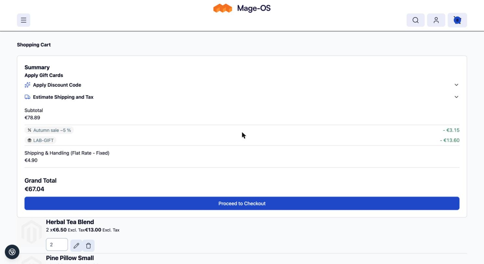
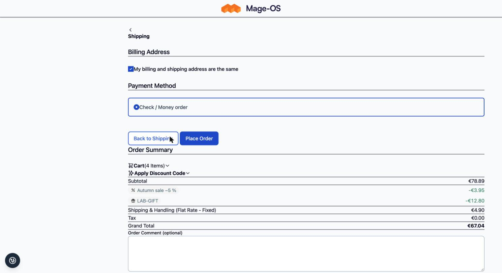

# Discount Lines for Amasty Free Gift

Adapter for [`pixelperfectat/magento2-module-discount-lines`](https://github.com/pixelperfectat/magento2-module-discount-lines):
an Amasty Free Gift coupon appears as a **gift line** ("Gift" in place of an amount) on the cart, in the checkout,
on the order and in the sales emails and documents.

## Requirements

- `pixelperfectat/magento2-module-discount-lines`
- Amasty Free Gift (`amasty/promo`, commercial; not a hard dependency of this package, the module is sequenced after
  `Amasty_Promo`)

## Installation

```bash
composer require pixelperfectat/magento2-module-discount-lines-amasty-promo
bin/magento setup:upgrade
```

## How it works

Amasty books a gift as a sales rule action (`ampromo_items`, `ampromo_cart`, `ampromo_spent`, `ampromo_product`,
`ampromo_eachn`): the gift product is added to the cart and discounted by the rule (normally 100 %), so Magento
reports a money discount for the rule. Rules are identified only by the action prefix (`ampromo_`, a constructor
argument of `GiftRuleMatcher`); no Amasty class is used.

The module adjusts two resolvers of the base module's composite:

- **`rule_discounts` is replaced by `GiftCouponLineResolver`**, a wrapper around the base rule resolver. The line of a
  gift rule that needs a coupon becomes kind `gift` (code and label = the coupon) and keeps its amount, so the lines
  still add up to the cart discount. The renderers show "Gift" only for an amount of 0 and the amount otherwise; documents
  print "Gift: CODE" with the amount.
- **`amasty_promo` (`AmastyGiftResolver`)** covers the case without a money discount: the coupon is applied but the
  gift is not in the cart yet (for example the customer still has to pick it). It returns a `gift` line with amount 0.
  It adds nothing when the rule already has a money line.

Automatic gift rules (no coupon) keep their `automatic` line with the store label when they discount something, and
produce no line otherwise. Non-gift coupons are untouched.

## Configuration

Configured in the base package under Stores > Configuration > Sales > Discount Lines (store-view scope):
`pp_discount_lines/general/enabled` (default `1`) and `pp_discount_lines/display/variant` (`A` to `D`, default `B`).
See the [base README](https://github.com/pixelperfectat/magento2-module-discount-lines#configuration) for the full table.

## Contract

The data this package renders (`extension_attributes.discount_lines`, row data key `discount_line`, the label rule
and the line kinds) is described in the
[contract section of the base README](https://github.com/pixelperfectat/magento2-module-discount-lines#contract-with-the-sales-email-module).

## Known limits

- Orders placed before the base module was installed keep the merged core row.
- Existing carts show the core row until the next totals collect.
- If a gift is auto-added during a collect, core has no per-rule breakdown for it yet, so that collect shows the
  plain core row until the next collect.
- The gift attributor over-attributes when an automatic rule also discounts the gift item (the sum is unchanged).
  Recommendation: add the Amasty condition "is promo item = No" to your automatic rules.
- Two gift coupon rules on one item fall back to the core row.
- See the base README for the complete list of known limits.

## Compatibility

Tested with `amasty/promo` 2.17.5. On Mage-OS 3.x with Symfony 7 and recent PHP, some Amasty vendor packages need small
patches (console command return types); this package does not ship such patches.

## Screenshots

Placeholder data only, in `docs/screenshots/`:





## Development

```bash
composer install
composer check
```

## License

MIT, see `LICENSE`.
